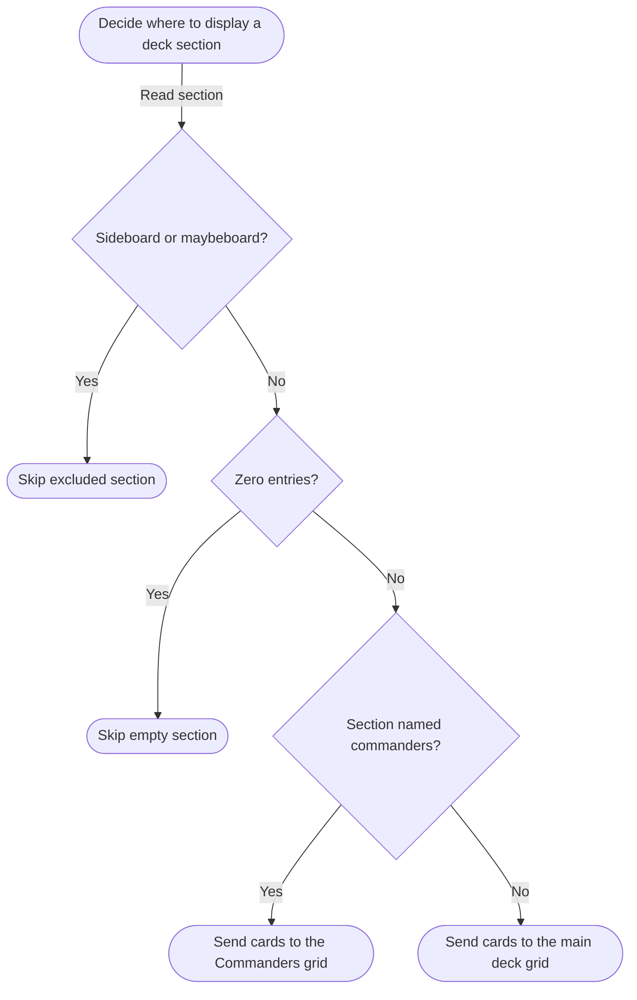

# Decision Tree

The deck preview checks each section in the Scryfall export to decide whether to skip it, show its cards in the Commanders grid, or show them in the main deck grid. The checks run in this order in [`deck_preview.js`](../js/deck_preview.js).

Is the section the sideboard or maybeboard?
    Yes - Skip it (These sections are generally not wanted for the final deck)
    No - 
        Is the section empty?
            Yes - Skip it (Some sections can be empty. No reason to process them.)
            No - 
                Is the section named commanders?
                    Yes - Send to commanders grid (The deck's commander determines the deck identity. It should be kept seperate.)
                    No - Send to main deck grid (All other cards.)

# Flowchart

