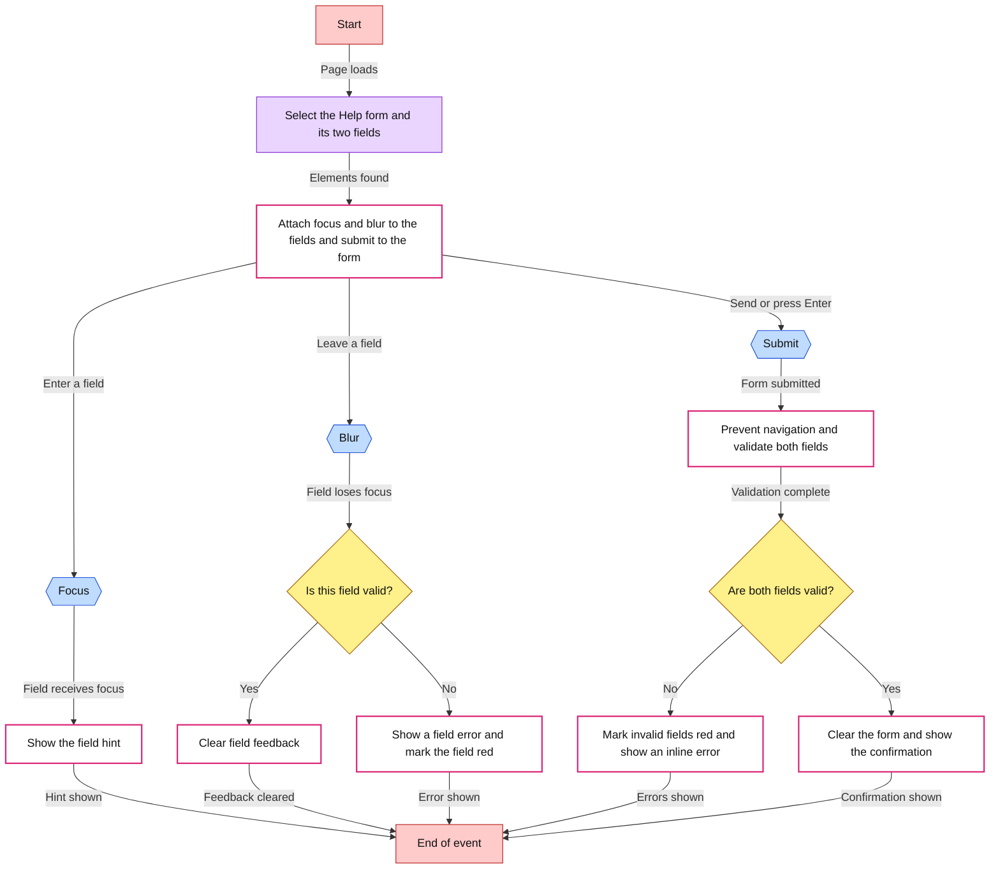

# Help Form Events

I used the Subject and Message fields on the Help page. When someone moves into either field, the `focus` listener shows what to enter. When they leave the field, the `blur` listener checks it and marks it red if it needs to be fixed. When they submit the form, the `submit` listener keeps them on the page and checks both fields. If either field is invalid, it marks that field red and shows a red message below the form. If both are valid, it clears the form and shows the confirmation. This is a front-end form demo.

# Event Handling Flowchart

# AI Assistance

I asked Codex to compare the assignment with the existing site and then complete the local work. It identified the Help form, added the event listeners and validation in `help_form.js`, connected the script to the Help page, and wrote this document and flowchart. I asked it to simplify the implementation to the assignment requirements. It also checked the focus, blur, and submit paths in Edge.
