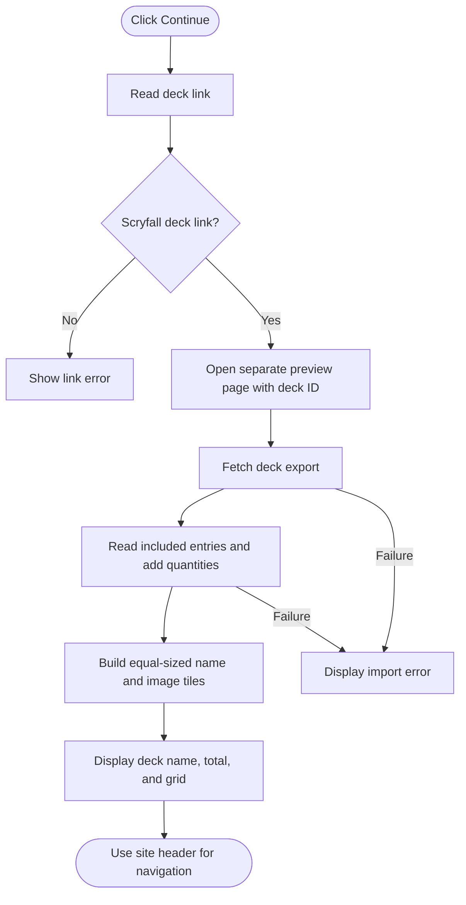

# Script Idea

The user pastes a public Scryfall deck link on `add-new-mtg-proxy-deck.html` and clicks Continue. The script opens `mtg-deck-preview.html`, which imports the deck and displays its name, total card quantity, and a grid of card names and images. Each grid tile has the same dimensions, with a small name above an image that fills the column and keeps a 5:7 aspect ratio. The column count is calculated from the grid width and a desired card width in `updateGridColumns()` and updates when the window is resized. Images load directly from Scryfall URLs; no image files are saved to the project or processed by a backend.

The import includes commanders and Outside the Game, excludes sideboard and maybeboard, and ignores blank editor rows.

# Goals

- Import a real public Scryfall deck.
- Keep the existing Add New Deck layout intact.
- Display consistently sized card names and images on a separate page.
- Calculate the total number of cards.

# Task Breakdown

1. Select and cache the input and Continue button.
2. Read the entered link and check for a Scryfall deck ID.
3. Open the preview page with the deck ID in its URL.
4. Fetch the public deck export from Scryfall.
5. Loop through included card entries and add their quantities.
6. Create one grid tile per entry with its quantity, name, and direct Scryfall image URL.
7. Display the deck name and bold total, and size each name and image consistently.
8. Show an error if the import fails. Use the existing site header for navigation.

## Assignment Requirements in the Scripts

| Requirement | Implementation |
|---|---|
| String variables | Entered URL, button text, deck ID, and card names. |
| Numeric variables and arithmetic | Card quantities and `totalCards += quantity`. |
| `getElementById` | Selects Continue. |
| `getElementsByClassName` | Selects card names for consistent sizing. |
| `getElementsByTagName` | Selects card images for block display. |
| `querySelector` | Selects main and the deck-link input. |
| Cached queries | Stores query results in variables. |
| Read and update existing content | Saves the Continue button text and updates it before opening the preview. |
| `textContent` | Displays deck name, quantities, names, and errors. |
| `innerHTML` | Copies DOM-built bold markup containing the calculated total. |
| External scripts and comments | Both pages load external scripts with headers, regions, and AI documentation references. |

# Flowchart

# Testing

Tested the full navigation in Edge with the live Supernatural artifact tokens deck. The preview displayed 20 cards, and all 20 images loaded directly from Scryfall. The initial fixed-size version used 200 by 280 pixel images; the current grid scales images to their columns while keeping a 5:7 aspect ratio. Checked the grid at desktop and mobile widths, the site navigation, the original form layout, and browser runtime errors.

# AI Assistance

I asked ChatGPT to do the initial script and documentation work, then requested refinements to simplify the code, preserve my existing pages, and add a separate card preview grid. I manually reviewed and edited the code and asked questions about the JavaScript and layout as I worked through it.

The [detailed AI documentation](../../assignments/assignment7/richards_ai_documentation.md) contains the exact user and assistant messages from the start of Assignment 8 through my request to document the conversation.
